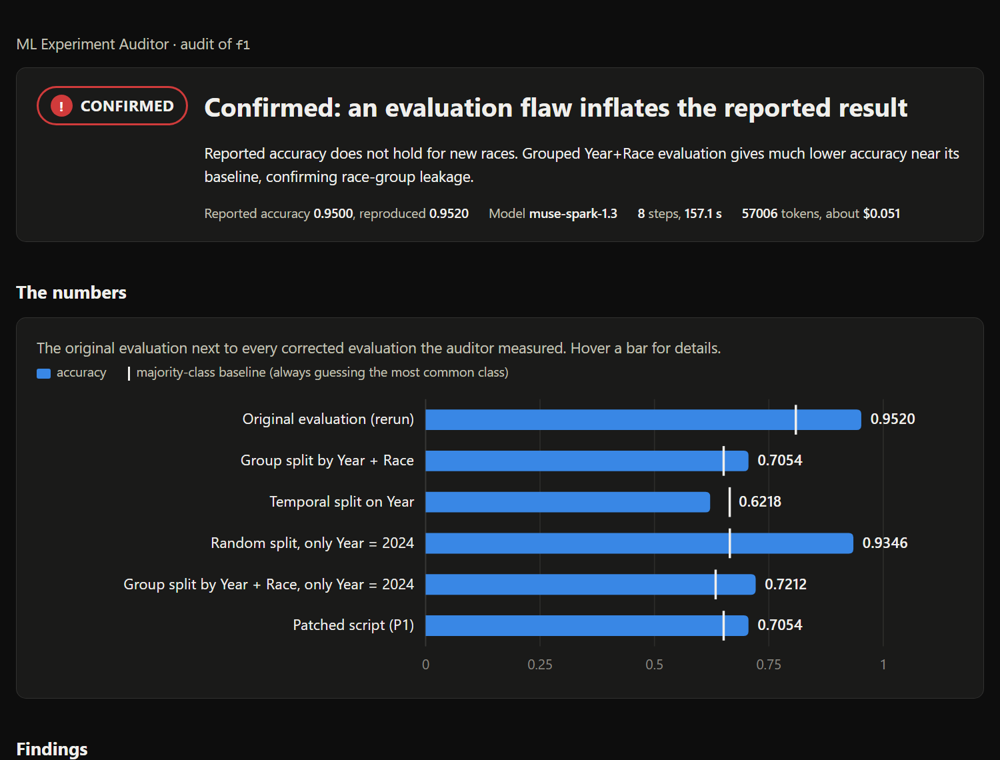

# ML Experiment Auditor

**An auditor for machine learning results.** It reruns a scikit-learn experiment in a sandbox,
finds evaluation flaws that inflate the score, fixes the evaluation, reruns it, and writes an
evidence report. A Meta model (Muse) leads the investigation through tool calling; plain code
does every measurement. *The model reasons, code measures.*



## Why

My F1 model predicted pit stops with **95% accuracy**. Trained on 2023 and tested on 2024, it
scored 62%. That drop alone proves nothing: pit laps were 3.1% of 2023 and 33.5% of 2024, so
the label mix changed too. Something was wrong, but what, and how much did it matter?

Leakage like this is common in published work, not only in side projects (Kapoor & Narayanan,
2023, *Leakage and the reproducibility crisis in machine-learning-based science*). The auditor
answers the question with evidence instead of suspicion. On the F1 project it found that every
race in the test set was also in the training set, separated that from the label shift (on 2024
alone: 0.935 with a random split, 0.721 with races kept apart), wrote a fix, and measured the
corrected score: **0.705**.

## Try it

```bash
python -m auditor.cli demo --replay   # no API key: replays two recorded audits, opens the reports
python -m auditor.cli demo            # live: Muse audits both projects (~4 min, ~$0.07)
```

Or use the local web page: pick a demo or upload your own project as a .zip, watch Muse's
investigation step by step, and read the report when it finishes. It runs only on your computer
(127.0.0.1), one audit at a time.

```bash
python -m auditor.cli serve           # opens http://127.0.0.1:8000
```

Or read the results directly: [F1 report](examples/f1/report.md) (confirmed) and
[clean project report](examples/clean/report.md) (not found). Each folder also has a
`report.html`: download it and open it in a browser.

## How it works

```
 your project ──> sandbox rerun ──> tracer ──> checks A / B / C ──┐
 (script, CSV,   (copy, no keys,   (which rows     (plain code)     │  tool results,
  audit.yaml)     timeout)          each fit and                    │  each an evidence id
                                    predict saw)                    v
                                                  Muse decides what to look at next,
                                                  re-evaluates with corrected splits,
                                                  proposes a fix ──> code validates it,
                                                  runs it, rechecks ──> verdict ──> code
                                                  validates the verdict ──> report
```

- **Sandbox.** Your project runs in a temporary copy with a scrubbed environment (no API keys),
  its own Python environment and a timeout. Original files are never modified.
- **Tracer.** A launcher wraps scikit-learn's `fit`, `predict`, `transform` and
  `train_test_split` and records which rows each call saw and from which line of your script.
  It never changes the result: every check also reruns the script untraced and compares.
- **Checks (deterministic).**
  **A** preprocessing fitted on rows that include the test set (scikit-learn objects through the
  trace; plain-pandas statistics by reading the script).
  **B** features not known at prediction time: Muse proposes suspects from their meaning and
  the `prediction_time` sentence, code measures each with a shuffle rerun.
  **C** the same entities (patients, races) or later periods in both train and test.
- **Agent.** Muse calls tools (`read_file`, `run_baseline`, `run_check`, `run_with_split`,
  `propose_patch`, `run_patched`, `finalize`). `run_with_split` reruns your unchanged script
  with its split swapped for a grouped, temporal or single-period one.
- **Guardrails.** Every claim must cite evidence ids; `confirmed` needs a flagged check; every
  number in Muse's text must appear in a tool result (an invented number is rejected and sent
  back). A fix may change the evaluation only: code rejects any change to how the model is
  built. Step and token caps end an audit as `inconclusive`, never as a guess.
- **Report.** `report.md`, `report.json` and a self-contained `report.html`, built by code from
  the evidence, plus the full transcript.

## Results

A benchmark of 20 generated projects (five themes, flaws labelled by type in the Kapoor &
Narayanan taxonomy, plus clean controls), comparing three systems. Six projects are held out:
their answer keys were committed with a fingerprint ([HELDOUT_LOCK.txt](benchmark/HELDOUT_LOCK.txt))
before any audit ran on them, and they were run once. Full table: [benchmark/RESULTS.md](benchmark/RESULTS.md).

| | Rules only | **Muse + tools (this auditor)** | Muse only (no tools) |
|---|---|---|---|
| Exact answers | 19/20 | **19/20** | 18/20 |
| False alarms on 7 clean projects | 0 | **0** | 1 |
| Fixes that reached the correct score | n/a | **13/13** | n/a |
| Mean error of the corrected score | n/a | **0.0009** | 0.068 (estimated) |
| Held-out set, exact answers | 6/6 | **6/6** | 5/6 |
| Same verdict in 3 repeated audits (4 projects) | n/a | **12/12** | n/a |
| Cost per audit | free | $0.035 | $0.011 |

What this shows, plainly: on these projects, fixed rules detect flaws as well as the auditor.
What only the auditor does is measure the truth: it writes the fix, reruns it and reports the
corrected score (off by 0.0009 on average), with every claim tied to evidence. Muse without
tools spots most flaws, but its estimates of the real score are off by about 7 points and it
accused one honest project.

## Limitations

- Tabular projects in Python with pandas and scikit-learn, one CSV, a run of a few minutes.
- Row identity comes from pandas indexes; scripts that only use plain arrays get weaker evidence
  (row counts) or `not_applicable`.
- Check B cannot see how a feature was computed. A 3-day average that secretly includes the next
  day was reported as `inconclusive` (correctly suspicious, not proven) in the benchmark.
- The benchmark projects are synthetic. They test the method, not every real-world codebase.
- Data note: with Meta Model API free credits, content sent to the model may be used by Meta for
  product improvement. The auditor sends the script, column names, a few example values and the
  `prediction_time` sentence. Only audit projects you are comfortable sharing.

## Setup

Python 3.14 (pandas 3.0.1 has no wheels for 3.15 yet).

```bash
git clone https://github.com/Mr-Freestyler21/ml-experiment-auditor.git
cd ml-experiment-auditor
py -3.14 -m venv .venv          # macOS/Linux: python3.14 -m venv .venv
.venv\Scripts\activate          # macOS/Linux: source .venv/bin/activate
pip install -r requirements.txt
python -m auditor.cli demo --replay
```

For live audits, copy `.env.example` to `.env` and set `META_MODEL_API_KEY` (a Meta Model API
key) and `AUDITOR_MAX_TOKENS` (a per-audit cap; 200000 is plenty).

## Commands

```bash
python -m auditor.cli baseline demo/f1    # rerun in the sandbox, compare with the reported score
python -m auditor.cli check demo/f1       # the three checks (add --no-llm for rules only)
python -m auditor.cli audit demo/f1       # full audit; writes runs/audit-<time>/report.{md,json,html}
python -m auditor.cli demo [--replay]     # the demo
python -m auditor.cli serve               # local web page: pick or upload a project, watch it live
python -m pytest -q                       # tests (no API calls; the model is scripted)
```

To audit your own project, add an `audit.yaml` next to the script (see
[demo/f1/audit.yaml](demo/f1/audit.yaml)): the entry script, data file, target, the reported
metric and value, a `prediction_time` sentence, and optionally `group_columns` (entities that
will be new in real use) and `time_column`. The script must write `metrics.json` to the folder
in `AUDIT_OUTPUT_DIR`.

## Benchmark

```bash
python -m benchmark.generate --verify-lock    # held-out answer keys unchanged since the lock
python -m benchmark.run --split dev           # rules, Muse + tools, Muse only
python -m benchmark.run --split heldout
python -m benchmark.combine --main <dev run> <heldout run> --repeats <repeats run>
```

Answer keys live in `benchmark/answers/`, outside the folders the auditor reads, and each
project is audited from an anonymous copy. The notes in [RESULTS.md](benchmark/RESULTS.md) list
every change made while developing against the development set.

## Repository

```
auditor/       sandbox, tracer, checks, agent (client, tools, loop, prompts, verdict), patching, reports,
               CLI, demo, web (local page)
benchmark/     project generator, answer keys, runner, scoring, RESULTS.md
demo/          f1 (the origin story) and clean (an honest project)
examples/      recorded audits with reports and evidence
tests/         unit and end-to-end tests
```

Built for the Meta Global AI Developer Hackathon (October 26 to November 4, 2026). The F1
project predates the hackathon and is used only as an audit target: see
[demo/f1/README.md](demo/f1/README.md).
